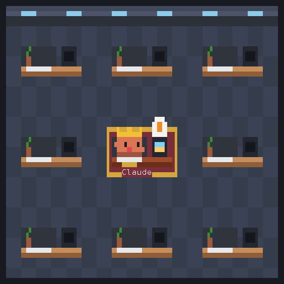
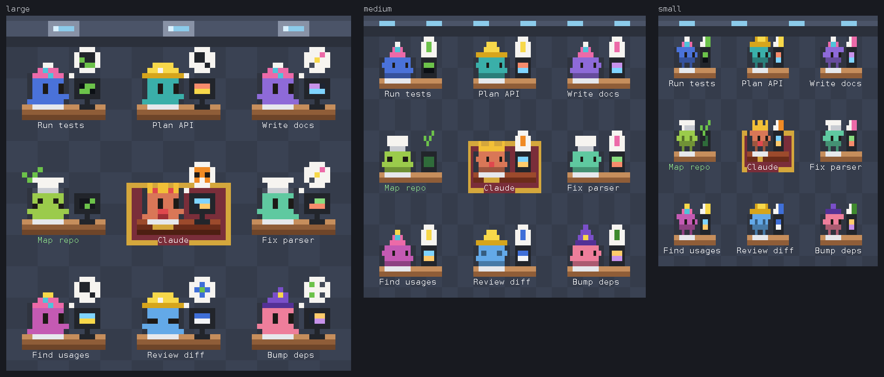
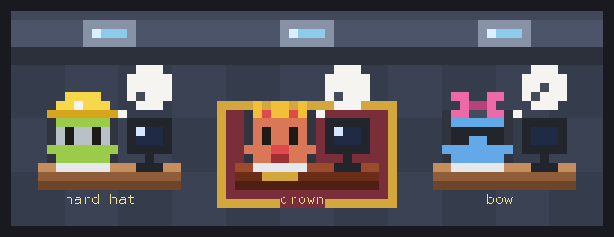

<div align="center">

# 🏭 Factory View

**A pixel-art office for Claude Code: watch Claude and its subagents work at their desks.**




[Install](#-install) · [What you see](#-what-you-see) · [Three sizes](#-three-sizes) · [Dress them up](#-dress-them-up) · [Commands](#%EF%B8%8F-commands) · [FAQ](#-faq)

</div>

Factory View is a Claude Code mod that visualizes multi-agent orchestration. When Claude
works with subagents, a lot happens at once and most of it is out of sight; Factory View
turns it into a little office in a pane beside the conversation. Claude, the main agent, is
the manager at the gilded desk in the middle of the floor; every subagent it starts takes a
desk of its own around it. Agents at work type away while their monitor scrolls and a
thought bubble shows the tool they run; agents with nothing to do look around, doze off in a
stream of Zzz, or cheer with a green check when their task comes back.

Every agent is the Claude Code mascot, and every one of them can be dressed up.

## 📦 Install

At the prompt of a Claude Code terminal session:

```
/plugin install factory-view --marketplace metetik/claude-code-agent-factory-view-mode
```

Answer `y` to add the marketplace, pick a scope, and the pane opens. From a shell:

```sh
claude plugin install factory-view --marketplace metetik/claude-code-agent-factory-view-mode
```

In the desktop app, where `/plugin` does not run: click **+** next to the prompt box, then
**Plugins**, **Add marketplace** with `metetik/claude-code-agent-factory-view-mode`, then
**Add plugin**.

Then type `/factory-view demo` to fill the floor with six pretend agents, or give Claude a
task worth a few subagents and watch them get to work.

> Factory View is a mod, built on Claude Code's function hooks (early access). It was made
> and tested on Claude Code 2.1.302.

## 👀 What you see

| On the floor | Means |
| --- | --- |
| ⌨️ Arms typing, code scrolling on the monitor, a bubble over it | **working**: the bubble shows the tool: a magnifier for reading and searching, a pencil for edits, a terminal for Bash, a globe for the web, a little mascot for handing out work, a checklist for todos, `…` for thinking (colors stand for them on the smaller desks) |
| 🫧 Eyes looking around, a bubble of dots | **waiting**: the manager waits for you; a subagent waits to start, or for a message |
| ✅ Happy eyes, arms up, a green check | **done**: the task came back |
| 💤 Eyes closed, Zzz rising, screensaver | **sleeping**: idle for a while; a finished agent keeps its check |
| ❗ X eyes, a red `!`, a red screen | **failed** |

The manager dozes off 90 seconds after the last turn ends; a finished subagent cheers for 20
seconds, then naps at its desk. Desks fill nearest the manager first, ringing outward; when
24 are taken, the agent that finished longest ago goes home to make room.

Under the floor, a legend lists every agent with what it is doing right now, the tool and
what it works on (`Grep: TODO`, `Edit: parser.ts`). In the desktop and mobile apps, hover a
desk for the same.

## 📏 Three sizes

<div align="center">

</div>

A terminal cell is the smallest thing a terminal can draw, so each size has pictures of its
own. **Large** draws in half blocks, two square pixels a cell, the mascot 8 cells wide.
**Medium** (the default) and **small** draw in quarter blocks, 2x2 pixels a cell, the
mascot 6 and 4 cells wide, with every hat and extra redrawn for them. A 3x3 floor takes 66,
54 or 42 columns. A name tag can't shrink with its desk (a letter is a cell), so it borrows
the floor beside it: 21, 17 and 13 letters.

Claude Code Desktop and the mobile app draw the same floor as an animated SVG, scaled by
the same size. Switch with **Size** under the legend, or `/factory-view size`.

## 🎩 Dress them up

<div align="center">

</div>

**14 colors** · **18 hats**: crown, top hat, cap, beanie, wizard hat, party hat, hard hat,
chef's hat, cowboy hat, safari hat, propeller cap, headphones, bow, halo, antenna, grad cap,
viking helmet, sprout · **8 extras**: glasses, shades, monocle, tie, bow tie, mustache,
scarf, blush.

Pick an agent in the legend and choose its color, hat and extra from the lists (the mobile
app steps through them with buttons), for that agent alone or for every agent of its type.
**Random** draws a new look, **Reset** takes the choice back, **Transcript** opens that
subagent's conversation.

Agents nobody dressed draw a look of their own by lot. Prefer uniforms? Switch
**Undressed agents** to *looks by type*: Explore agents in safari hats, general-purpose ones
in hard hats, Plan in wizard hats. The manager keeps its crown and tie until you change
them, and nobody else draws the crown by chance. Looks chosen for the manager and for types
are remembered across sessions.

## ⌨️ Commands

| Command | Does |
| --- | --- |
| `/factory-view` | open or close the pane (closing it keeps it closed in later sessions) |
| `/factory-view demo` | add or remove six pretend agents, to see a busy floor |
| `/factory-view style <who> color=<c> hat=<h> extra=<e>` | dress the manager (`main`), every agent of a type (`Explore`, `Plan`, …), or one agent by its name tag |
| `/factory-view reset [who]` | back to the default looks |
| `/factory-view looks random\|type` | how agents nobody dressed look |
| `/factory-view size small\|medium\|large` | how big the agents are drawn |
| `/factory-view clear` | send finished agents home |
| `/factory-view options` | list the colors, hats and extras |

## 🔒 Privacy

Factory View runs entirely inside Claude Code. It makes no network requests, calls no model,
runs no commands and sends no telemetry. It reads the session's own agent and tool events
(which agent runs which tool, and a few words of that tool's input, such as a file name or
the start of a command) to draw them, keeps them in the session's memory, and saves only the
looks and settings you choose, in Claude Code's plugin store on your machine.

## ❓ FAQ

**How do I see what my Claude Code subagents are doing?**
Install Factory View and the pane opens beside the conversation. Every subagent gets a desk,
its thought bubble shows the kind of tool it runs, and the legend under the floor names the
tool and what it works on, for every agent at once.

**Does it work in Claude Code Desktop and the mobile app?**
Yes. The terminal draws the floor in block characters; Claude Code Desktop and the mobile
app draw it as an animated SVG, with hover text on each desk.

**Does it slow Claude down or cost tokens?**
No. It adds nothing to the prompt and makes no model calls; it only watches the events the
session already has.

**Does it work with agent teams and background agents?**
Yes. Teammates and background agents get desks like any subagent; a teammate waiting for a
message looks around, then dozes off.

**Which Claude Code version do I need?**
Factory View is a mod, built on function hooks, which are early access; it was made and
tested on Claude Code 2.1.302. Installing with `/plugin install … --marketplace` in a
session needs 2.1.275 or later, and from the shell 2.1.292 or later.

**Is this an official Anthropic project?**
No. Factory View is a community mod and is not affiliated with Anthropic.

## 🔧 How it works

`hooks/register.tsx` follows the session: `turn.start` and `turn.complete` for every loop,
the main one and each subagent's, `tool.call` for the tool each agent runs, and
`$.agent.list()` every two seconds to catch anything missed. What it learns lives in
`$.state`, so the pane redraws on every change and survives a reload. The terminal's picture
is a `Raster` repainted four times a second with `$.ui.blit`; the remote surfaces get an SVG
whose frames play by SMIL, so it animates with no redraws at all.

| File | Holds |
| --- | --- |
| `hooks/register.tsx` | the hooks: events, the pane, the `/factory-view` command, the animation ticker |
| `hooks/model.ts` | agents, desks, status changes and styles, as plain functions |
| `hooks/scene.ts` | the floor plan and the pixel painter, for every size |
| `hooks/sprites.ts` | colors, hats, extras and icons for the scaled SVG |
| `hooks/minis.ts` | the same for the large terminal desks |
| `hooks/tinies.ts` | the same for the medium and small desks, in quarter blocks |
| `hooks/paint.ts` | the picture as terminal cells (half or quarter blocks), and as an SVG with its frames |
| `types/index.d.ts` | the shape of the mod's state |
| `tests/factory.test.ts` | the floor plan, the agents, the session and the pane |

## 🛠️ Developing

```sh
claude plugin validate .
claude plugin test .
claude --plugin-dir .            # a session with the mod loaded from this folder
bun scripts/preview.ts out 8 5   # the floor with 8 agents as SVG and ANSI, outside a session
```

`tsc -p .` type-checks the mod once Claude Code has loaded it from this folder, which lays
the API's declarations in `.claude-plugin/types/`.
